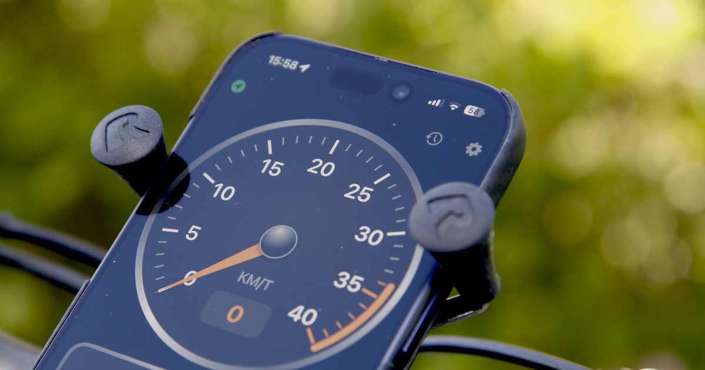

# BikeSpeed Marketing Page

The marketing website for **[BikeSpeed](https://github.com/klekanger/BikeSpeed)** — a simple, free GPS speedometer for cyclists. No ads, no subscriptions, open source. Live at **[bikespeed.no](https://bikespeed.no/)**.



## About the app

BikeSpeed turns an iPhone or Android phone into a fullscreen, handlebar-mounted GPS speedometer styled after vintage 80s car dashboards. It's an intentionally distraction-free app — no setup, no accounts, no configuration.

- Analog speed gauge with a 270° dial and configurable max speed
- Digital speed readout and heading indicator (arrow + compass letters + street name)
- Live trip stats: average and max speed, distance, duration, altitude, climb, descent and gradient
- Auto-pause, and recording that continues with the screen locked
- Trip log with route maps, height and speed profiles, lifetime totals and personal bests
- GPX export, plus automatic iCloud sync of the trip log on iOS (the Android version stores rides on the device only)
- Metric/imperial units and bilingual UI (English & Norwegian)
- Available for iOS 18+ and Android 11+, MIT licensed

Both platforms are on **version 2.0**, which is what the site currently markets.

- **iOS:** [App Store](https://apps.apple.com/us/app/bikespeed-gps-speedometer/id6788777869)
- **Android:** [Google Play](https://play.google.com/store/apps/details?id=no.lekanger.bikespeed)

The app source lives in two repos:

- **iOS** (Swift): [github.com/klekanger/BikeSpeed](https://github.com/klekanger/BikeSpeed)
- **Android**: [github.com/klekanger/BikeSpeed-Android](https://github.com/klekanger/BikeSpeed-Android)

## About this repo

A small static marketing site built with [Vite](https://vitejs.dev/) and TypeScript (no framework). It renders an animated SVG gauge, screenshots, and App Store and Google Play badges, with a hand-rolled i18n layer that auto-detects English or Norwegian from the browser and remembers the choice in `localStorage`.

The site has three pages, each with its own entry point in `vite.config.ts`:

- `index.html` — landing page
- `privacy.html` — privacy policy
- `support.html` — support page

### Project structure

```
index.html, privacy.html, support.html   Page entry points
public/                                   Static assets (photos, screenshots, icons, store badges, og-image)
src/
  main.ts            Landing page bootstrap
  layout.ts          Page markup
  gauge.ts           Animated SVG speed gauge
  privacy.ts         Privacy page
  support.ts         Support page
  style.css          Styles
  i18n/
    locale.ts        Locale detection + persistence
    translations.ts  English & Norwegian strings
```

## Development

```bash
pnpm install     # install dependencies
pnpm dev         # start the dev server
pnpm build       # type-check and build to dist/
pnpm preview     # preview the production build
```
